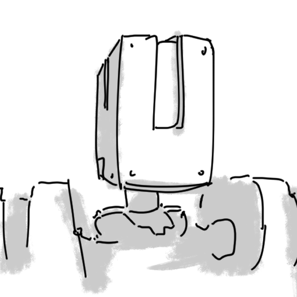

# Michael Couey
Low-level computer science nerd, artist, writer, and musician.

## About Me
### Actual details:
- Student at **SUNY New Paltz.**
- **Autistic**.
- **ADHD**-addled.

### Favorite snacks:
1. Peanut Butter M&Ms (they're *really* good and the vending machines on campus sell them)
2. Pop Corners (any flavor, they're all good)
3. Popcorn (obvi)
4. Rice (the most versatile food item since **ever**)
5. Clif Bars (they sell them locally *AND* they're cheap eats, so... om nom nom)


### Some links and images:
- [The Wayward Webring](https://waywardweb.org/), a webring for link collectors.
- [The RTW Webring](https://rewildtheweb.org/webring/), a webring for retro-web enthusiasts.
- 
- 

### Inspirational quote:
> "Good luck, have fun, don't die." - Someone In The 1990s Gaming Scene

## Technical Background
Experience with *basic* **HTML**, **CSS**, and **Linux terminal usage**.

```bash
echo "The Linux terminal is very intuitive once you've got your bearings."
```

### Useful commands:
`ls`, `cd`, `rm`, `mv`, `cp`, `cat`.

## Goals
- [ ] Pass this course.
- [x] Live.
- ~~[x] Gluten Free Hamburger~~